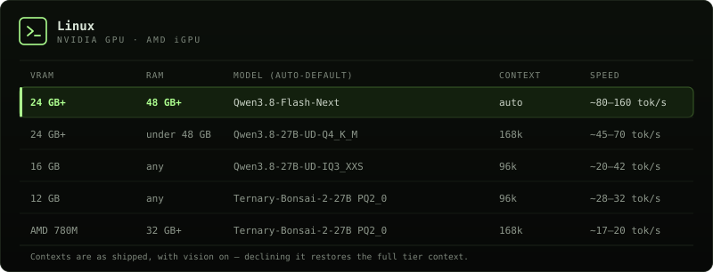
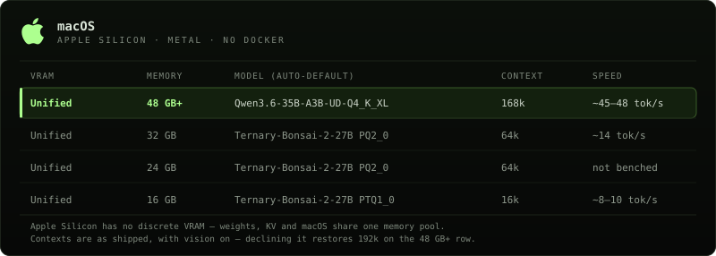

<div align="center">
  
</div>

<div align="center">
  <strong>Open-source coding agent. Local-first. Zero cost. Zero cloud.</strong><br/>
  <sub>Built to democratize AI. Powered by .NET.</sub>
</div>

<br>

<div align="center">
  <a href="#quickstart">Quickstart</a> · <a href="#free-course--get-started-with-oma">Free OMA Course</a> · <a href="#whats-shipping">What's shipping</a> · <a href="#how-it-compares">How it compares</a> · <a href="#whats-inside">What's inside</a> · <a href="#agent-host-whole-machine-mode">Agent Host</a> · <a href="#supported-hardware">Hardware</a> · <a href="#pick-your-model">Models</a> · <a href="#docs">Docs</a> · <a href="ROADMAP.md">Roadmap</a> · <a href="#contributing">Contributing</a>
</div>

<br>

<div align="center">
  
  <a href="https://www.youtube.com/playlist?list=PLJ7vIYQ-dfw4">
    
  </a>
  <a href="docs/MODELS.md#why-qwen38-gpu--qwen36-cpu">
    
  </a>
</div>

<br>

<div align="center">
  
  
  
  
  
  
  
</div>

---

OpenMono is a coding agent that runs **entirely on your hardware**. No subscriptions, no data leaving your network, no per-token billing. It pairs a .NET 10 CLI with its own llama.cpp inference server, giving you a full agentic loop with **21 built-in tools**, Docker sandboxing, and deep code intelligence. NVIDIA GPU, AMD APU (Ryzen 9 7940HS / Radeon 780M iGPU, unified memory), CPU, or Apple Silicon (Metal). **It auto-configures itself**. You own the model, the compute, and the data.

---

<!--  ── FREE OMA COURSE ─────────────────────────────────────── -->
## Free Course — Get Started with OMA

<div align="center">
  <a href="https://www.youtube.com/playlist?list=PLJ7vIYQ-dfw4">
    
  </a>
  <br/>
  <sub><a href="https://openmonoagent.ai/contact">Need help? Contact us — we'll help you get set up.</a></sub>
</div>

---

## Quickstart

One command. Auto-detects an NVIDIA GPU, the AMD Ryzen 9 7940HS iGPU (Radeon 780M), CPU, or Apple Silicon. Installs model, runtime, and Docker containers.

```bash
bash <(curl -fsSL https://raw.githubusercontent.com/StartupHakk/OpenMonoAgent.ai/refs/heads/main/get-openmono.sh)
```

Then from any project:

```bash
openmono agent            # TUI mode (default)
openmono agent --classic  # classic scrolling terminal
```

<sub><a href="docs/SETUP.md">→ Full command reference</a>. Daily commands, setup flags, GPU/iGPU options · <a href="https://openmonoagent.ai/contact">Need help? Book a call</a></sub>

<br/>

<div align="center">
  
</div>

---

<!--  ── WHAT'S SHIPPING ─────────────────────────────────────── -->
## What's shipping

<div align="center">
  
</div>

<sub><strong>Get them:</strong> <code>openmono setup search</code> · <code>OPENMONO_VISION_ENABLED=1</code> · <a href="https://apps.apple.com/us/app/openmono-ai-coding-agent/id6766077801">App Store</a> · <a href="https://play.google.com/store/apps/details?id=ai.openmonoagent.app&hl=en_US">Google Play</a> · <a href="https://marketplace.visualstudio.com/items?itemName=StartupHakk.openmono-agent">VS Code Marketplace</a></sub>

---

<!--  ── HOW IT COMPARES ─────────────────────────────────────── -->
## How it compares

Most coding agents are cloud products wearing an open-source label. Your prompts, your code, and your context hit someone else's servers on every keystroke. OpenMono runs the model on your hardware — after the one-time setup, **inference costs nothing**. Your code never leaves the machine. No account. No usage dashboard. No API key.

<div align="center">
  <a href="docs/ARCHITECTURE.md"></a>
</div>


→ [Full architecture + diagram](docs/ARCHITECTURE.md) · [5 provider backends](docs/MODELS.md) · runs at **~45 tok/s on GPU**, ~20 tok/s on AMD iGPU (APU)

---

## What's inside

<table>
<tr>
<td width="50%" valign="top">

<strong style="color:#A3FF66;">01</strong> · **Bundled inference — zero config, zero cost**  
llama.cpp ships inside Docker. Installer detects your hardware and picks the right model. After setup, every token is free.

`GPU` Qwen3.8-27B dense · ~60 tok/s  
`iGPU` Qwen3.6-35B-A3B MoE · APU unified memory · ~20 tok/s  
`Mac` Qwen3.6-35B-A3B MoE · Metal · ~45 to 48 tok/s

→ [Models & reasoning mode](docs/MODELS.md)

</td>
<td width="50%" valign="top">

<strong style="color:#A3FF66;">02</strong> · **Agentic loop that earns its name**  
Up to 1,000 iterations per turn. Doom-loop detection nudges on repeated tool batches, escalates the nudge at 3 consecutive detections, and ends the turn at 5. Checkpoints at 65% context fill, compacts at 80%. Runs until done — then stops.

</td>
</tr>
<tr>
<td valign="top">

<strong style="color:#A3FF66;">03</strong> · **[21 tools](docs/ARCHITECTURE.md), guarded pipeline**  
Every call: parse → schema validate → path sanity → plan-mode gate → host-mode gate → permission check → cache → pre-hook → execute → post-hook → artifact store → cache write → invalidate. Read-only tools run in parallel. Nothing bypasses the pipeline.

</td>
<td valign="top">

<strong style="color:#A3FF66;">04</strong> · **5 specialist sub-agents**  
Isolated sessions with locked tool sets and turn budgets:

`Explore` · read-only discovery · 100 turns  
`Plan` · architecture, no writes · 100 turns  
`Coder` · full file access · 300 turns  
`Verify` · adversarial + Roslyn · 150 turns  
`general-purpose` · everything · 200 turns

</td>
</tr>
<tr>
<td valign="top">

<strong style="color:#A3FF66;">05</strong> · **Docker sandbox**  
In sandbox mode the project mounts as `/workspace`. The agent reads and writes your real files. That mount is the blast radius; nothing outside it is visible. [Agent Host](#agent-host-whole-machine-mode) is the explicit exception: machine-level actions run only through approved `HostExec` calls.

</td>
<td valign="top">

<strong style="color:#A3FF66;">06</strong> · **Deep code intelligence**  
Roslyn: type hierarchy, blast-radius, cross-file symbol search, callers, diagnostics — 5-min compilation cache. LSP for TypeScript, Python, Go, Rust, lazy-started on first use.

Auto-detects [graphify](docs/graphify.md) (semantic concept graph, 25+ languages) and [code-review-graph](docs/code-review-graph.md) (structural call graph via MCP, ~22 tools) if installed — no config needed.

</td>
</tr>
<tr>
<td valign="top">

<strong style="color:#A3FF66;">07</strong> · **[Playbooks](docs/PLAYBOOKS.md)**  
YAML workflows with typed parameters, conditional gates, and checkpoint/resume.

</td>
<td valign="top">

<strong style="color:#A3FF66;">08</strong> · **[5 provider backends](docs/MODELS.md)**  
Local llama.cpp is the default; Strata is the supported Linux high-end backend. OpenAI, Anthropic, and Ollama are available but WIP — see [Models](docs/MODELS.md) for details. Providers are selected in `settings.json` at startup; `/model` switches the model on the active provider.

</td>
</tr>
<tr>
<td valign="top">

<strong style="color:#A3FF66;">09</strong> · **Distributed inference**  
Agent on your laptop, inference on a separate GPU machine. No port forwarding — tunnel is established outbound from the inference box. Free relay at [app.openmonoagent.ai](https://app.openmonoagent.ai).

→ [Dual-box setup guide](docs/SETUP.md#dual-box-setup)

</td>
<td valign="top">

<strong style="color:#A3FF66;">10</strong> · **Vision**  
Attach images in chat with `@screenshot.png` or ask the agent to read any image file. The multimodal projector (mmproj) is downloaded automatically at setup. Supported formats: PNG, JPG, GIF, WebP. Large images are auto-resized to fit within the image budget. Enable vision in `settings.json` (`inference.vision_enabled`) or set `OPENMONO_VISION_ENABLED=1`.

→ [Vision setup & usage](docs/SETUP.md#vision)

</td>
</tr>
<tr>
<td valign="top">

<strong style="color:#A3FF66;">11</strong> · **Private web search & scraping**  
Self-hosted search via SearXNG — your queries never leave the machine. Anti-bot scraping via Scrapling + Camoufox (real browser, Cloudflare bypass). Single Caddy gateway, auto-detected. Falls back to DuckDuckGo / direct fetch when the gateway is absent.

`openmono setup search` · `openmono setup scraper`

→ [Web services architecture](docs/ARCHITECTURE.md#inference-side-web-services-caddy-gateway)

</td>
<td valign="top">

<strong style="color:#A3FF66;">12</strong> · **VS Code extension**  
The full agent loop in your editor sidebar — streaming responses, live Markdown, file edits, bash, and permission prompts without leaving VS Code. Connects to the local agent over ACP on port `7475`. Also works in Cursor.

`code --install-extension StartupHakk.openmono-agent`

→ [Extension docs](docs/SETUP.md#vs-code--cursor-extension) · [Marketplace](https://marketplace.visualstudio.com/items?itemName=StartupHakk.openmono-agent)

</td>
</tr>
</table>

<div align="center">
  
</div>

---

<!--  ── AGENT HOST ──────────────────────────────────────────── -->
## Agent Host (whole-machine mode)

HostExec is a first-class tool, backed by a host-bridge daemon that runs the command on the machine. It is opt-in. `openmono setup` offers it, and the default is No, because it breaks the container sandbox's isolation by design. Add it later with `bash scripts/install-host-bridge.sh`. Non-interactive:

```bash
OPENMONO_HOST_BRIDGE=1 OPENMONO_HOST_EXEC_DEFAULT=ask openmono setup --agent
```

Drop `--agent` for the full role. Set `OPENMONO_HOST_EXEC_DEFAULT=allow` to skip the per-command prompt. The deny list, sudo policy, and audit log still apply.

`openmono upgrade` updates the checkout and rebuilds the agent image. `openmono upgrade --check` previews and does not apply. `openmono agent --host` starts the daemon, then the agent. Manage it with `openmono host daemon`, `status`, `stop`, `requests`, `approve <id>`, `deny <id>`, and `invite`. Inside the agent: `/host status`, `/host on`, `/host off`.

HostExec is available only while the session is paired. Parameters: `command`, `timeout_ms` (default 300000, max 600000), `background`, `as_root`. The default permission is Ask. The HostExec permission card is Allow, Allow all, Deny, or Deny all. A HOST EXECUTION card accepts allow once, allow all for this session, allow 30 minutes, allow today, deny, and deny all. A blanket allow never covers root. `host.sudo_policy` defaults to ask. The daemon that `openmono agent --host` starts has no one to prompt, so an ask policy fails closed: `as_root` runs only when `host.sudo_policy` is allow. The operator bridge prompts for each escalation when the policy is ask.

Settings live in `~/.openmono/host-bridge.json` (mode 0600): `host.exec_default` (ask, allow, or deny; default ask), `host.sudo_policy` (ask, allow, or deny; default ask), `host.run_as`, `host.allow_list`, `host.deny_list` (checked first), `host.timeout_ms`. Every command is audited under `~/.openmono/logs/`.

The daemon binds `127.0.0.1:7476` (`OPENMONO_HOST_DAEMON_PORT` overrides) plus the Docker bridge IP on Linux, and the vmnet bridge on macOS for Colima or Lima. It never binds `0.0.0.0`. Pair with the pair secret, a launcher invite, or an approval request you accept with `openmono host approve`. Invites are TTL-bounded, not single-use (default 900 seconds, range 30 seconds to 86,400 seconds). An idle pairing token expires after 2 hours.

Stand up a server, trace a crash from system logs, or install and configure software. You decide per call how far it reaches.

→ [Host bridge settings](docs/CONFIG.md#host-bridge-openmono-agent---host)

---

<!--  ── SUPPORTED HARDWARE ──────────────────────────────────── -->
## Supported Hardware

<div align="center">
  
</div>

<br/>

<div align="center">
  
</div>

<sub>Setup auto-detects GPU, iGPU/APU, and Apple Silicon. No prompts. Pass <code>--options</code> to choose the model, vision, and parallel slots yourself, or <code>--model=&lt;name&gt;</code> to pin one. See <a href="#pick-your-model">Pick your model</a> for the menu, flags, and Linux context presets. The pick depends on VRAM <em>and</em> system RAM: on Linux a 24 GB+ card gets Qwen3.8-Flash-Next (Strata) on a 48 GB-class box and Qwen3.8-27B below that, a 16 GB card keeps Qwen3.8-27B, and a 12 GB card and AMD 780M iGPUs (Ryzen 9 7940HS, 32 GB+ RAM) get Ternary-Bonsai-2-27B via Prism. CPU mode runs Qwen on stock llama.cpp (about 20 GB RAM). Linux setup is for Ubuntu and Ubuntu derivatives, tested on Ubuntu 24.04 LTS. On macOS, the full and inference roles require Apple Silicon (M1+); 48 GB+ unified memory is the recommended, tested configuration. 24 to 47 GB and 16 to 23 GB Macs run Ternary-Bonsai (PQ2_0 / PTQ1_0) with a tighter context window. Intel Macs: agent-only mode. macOS 14+ (Sonoma/Sequoia) recommended.</sub>

### Pick your model

By default, setup picks a model for the hardware and does not ask. On a terminal, `openmono setup --options` shows a menu of what this machine can run. The default answer is 1, Qwen on stock llama.cpp (always available, the safe default). Pin one with `--model=qwen|bonsai-pq2|bonsai-ptq1|flash-next`. Shorthands: `--qwen`, `--bonsai`, `--bonsai-ptq1`, `--flash-next`.

**Qwen** is stock llama.cpp, including CPU mode (about 20 GB RAM). **Bonsai 2 27B** is a ternary build on the PrismML llama.cpp fork (PQ2_0 about 7.2 GB, PTQ1_0 about 5.9 GB). On Linux it runs on an NVIDIA GPU, or on the AMD Ryzen 9 7940HS iGPU (Radeon 780M) through the Prism Vulkan image. There is no CPU image. It keeps a real 27B on 12 GB NVIDIA cards, where Qwen drops to a 9B, and it is the auto-pick on that iGPU. **Qwen3.8-Flash-Next** runs on Strata: Linux, an NVIDIA GPU, and a 48 GB-class box (about 44 GiB or more of system RAM), with weights streamed from disk. Setup auto-picks it on those boxes when the card has 24 GB or more of VRAM. Otherwise it appears only in the `--options` menu, and only when the machine can run it.

Linux context presets, before the vision trim: Bonsai 196,608 on 24 GB, 131,072 on 16 GB, 98,304 on 12 GB, 32,768 on 8 GB. Qwen 196,608 on 24 GB and 180,224 on 16 GB. On a 24 GB card the two match. Bonsai's benefit is fitting a 27B model in less VRAM, not a longer window. Vision is on by default and trims the 24 GB preset to 172,032 for both (a 16 GB card goes to 98,304 for both).

---

<!--  ── NEED HELP ───────────────────────────────────────────── -->
## Need Help?

Stuck on setup, or want OpenMono on your own servers? We install and support private OpenMono deployments — contact us, book a call, and we'll walk you through getting it running on your hardware. Pick your hardware. We handle the rest.

<div align="center">
  <a href="https://openmonoagent.ai/contact">
    
  </a>
</div>

---

<!--  ── DOCS ────────────────────────────────────────────────── -->
## Docs

<table width="100%" style="border-collapse:collapse;background:#111111;border:1px solid #232323;border-radius:4px;">
  <tr>
    <td width="30%" style="padding:9px 16px;border-bottom:1px solid #1A1A1A;border-right:1px solid #232323;"><a href="ROADMAP.md"><code style="font-size:12px;">Roadmap</code></a></td>
    <td style="padding:9px 16px;border-bottom:1px solid #1A1A1A;"><sub style="color:#C8C8C0;">What's next</sub></td>
  </tr>
  <tr>
    <td style="padding:9px 16px;border-bottom:1px solid #1A1A1A;border-right:1px solid #232323;"><a href="docs/SETUP.md"><code style="font-size:12px;">Setup &amp; commands</code></a></td>
    <td style="padding:9px 16px;border-bottom:1px solid #1A1A1A;"><sub style="color:#C8C8C0;">Daily commands, TUI vs classic, flags</sub></td>
  </tr>
  <tr>
    <td style="padding:9px 16px;border-bottom:1px solid #1A1A1A;border-right:1px solid #232323;"><a href="docs/DEPLOYMENT-MODES.md"><code style="font-size:12px;">Deployment modes</code></a></td>
    <td style="padding:9px 16px;border-bottom:1px solid #1A1A1A;"><sub style="color:#C8C8C0;">Single-box vs split-box, server-ops runbook</sub></td>
  </tr>
  <tr>
    <td style="padding:9px 16px;border-bottom:1px solid #1A1A1A;border-right:1px solid #232323;"><a href="docs/ARCHITECTURE.md"><code style="font-size:12px;">Architecture</code></a></td>
    <td style="padding:9px 16px;border-bottom:1px solid #1A1A1A;"><sub style="color:#C8C8C0;">.NET CLI + llama.cpp + Docker, full diagram</sub></td>
  </tr>
  <tr>
    <td style="padding:9px 16px;border-bottom:1px solid #1A1A1A;border-right:1px solid #232323;"><a href="docs/MODELS.md"><code style="font-size:12px;">Models &amp; reasoning</code></a></td>
    <td style="padding:9px 16px;border-bottom:1px solid #1A1A1A;"><sub style="color:#C8C8C0;">Model tiers, reasoning mode, provider config</sub></td>
  </tr>
  <tr>
    <td style="padding:9px 16px;border-bottom:1px solid #1A1A1A;border-right:1px solid #232323;"><a href="docs/CONFIG.md"><code style="font-size:12px;">Configuration</code></a></td>
    <td style="padding:9px 16px;border-bottom:1px solid #1A1A1A;"><sub style="color:#C8C8C0;">settings.json, providers, permissions, MCP servers</sub></td>
  </tr>
  <tr>
    <td style="padding:9px 16px;border-bottom:1px solid #1A1A1A;border-right:1px solid #232323;"><a href="docs/CONFIG.md#host-bridge-openmono-agent---host"><code style="font-size:12px;">Host bridge</code></a></td>
    <td style="padding:9px 16px;border-bottom:1px solid #1A1A1A;"><sub style="color:#C8C8C0;">Whole-machine mode: consent, daemon, host-bridge.json</sub></td>
  </tr>
  <tr>
    <td style="padding:9px 16px;border-bottom:1px solid #1A1A1A;border-right:1px solid #232323;"><a href="docs/PLAYBOOKS.md"><code style="font-size:12px;">Playbooks</code></a></td>
    <td style="padding:9px 16px;border-bottom:1px solid #1A1A1A;"><sub style="color:#C8C8C0;">YAML workflows, typed params, checkpoint/resume</sub></td>
  </tr>
  <tr>
    <td style="padding:9px 16px;border-bottom:1px solid #1A1A1A;border-right:1px solid #232323;"><a href="docs/graphify.md"><code style="font-size:12px;">graphify</code></a></td>
    <td style="padding:9px 16px;border-bottom:1px solid #1A1A1A;"><sub style="color:#C8C8C0;">Semantic code graph, 25+ languages</sub></td>
  </tr>
  <tr>
    <td style="padding:9px 16px;border-bottom:1px solid #1A1A1A;border-right:1px solid #232323;"><a href="docs/code-review-graph.md"><code style="font-size:12px;">code-review-graph</code></a></td>
    <td style="padding:9px 16px;border-bottom:1px solid #1A1A1A;"><sub style="color:#C8C8C0;">Structural call graph via MCP</sub></td>
  </tr>
  <tr>
    <td style="padding:9px 16px;border-bottom:1px solid #1A1A1A;border-right:1px solid #232323;"><a href="docs/SETUP.md#vs-code--cursor-extension"><code style="font-size:12px;">VS Code extension</code></a></td>
    <td style="padding:9px 16px;border-bottom:1px solid #1A1A1A;"><sub style="color:#C8C8C0;">Chat panel for VS Code 1.85+ · also works in Cursor · <a href="https://marketplace.visualstudio.com/items?itemName=StartupHakk.openmono-agent">Marketplace</a></sub></td>
  </tr>
  <tr>
    <td style="padding:9px 16px;border-right:1px solid #232323;"><a href="CONTRIBUTING.md"><code style="font-size:12px;">Contributing</code></a></td>
    <td style="padding:9px 16px;"><sub style="color:#C8C8C0;">How to contribute</sub></td>
  </tr>
</table>

<br/>

<table width="100%" style="border-collapse:collapse;background:#111111;border:1px solid #232323;border-radius:4px;">
  <tr><td style="padding:14px 18px;">
    <span style="display:inline-block;background:#FF8C00;color:#0D0D0D;padding:2px 10px;border-radius:12px;font-size:10px;font-weight:700;letter-spacing:0.06em;">PUBLIC BETA</span>&nbsp;&nbsp;<sub style="color:#C8C8C0;">Early access is open — we're shipping updates fast. Try it out and tell us what you'd like to see next.</sub>
  </td></tr>
</table>

---

## Contributing

<table width="100%" style="border-collapse:collapse;background:#111111;border:1px solid #232323;border-radius:4px;">
  <tr><td style="padding:16px 18px 10px;">
    <sub style="color:#C8C8C0;">OpenMono is early and moving fast. Contributions are welcome — new tools, providers, LSP servers, playbooks, bug fixes, or docs.</sub>
  </td></tr>
  <tr><td style="padding:0 18px 14px;">
    <a href="CONTRIBUTING.md"><code style="font-size:11px;">→ Read the contributing guide before opening a PR</code></a>
  </td></tr>
</table>

---

<div align="center">
  <br>
  <em>"AI shouldn't be a subscription you rent. It should be infrastructure you own —<br>sitting on your desk, serving your code, answering only to you."</em><br><br>
  <sub>— Startup Hakk</sub>
</div>

<br>

<div align="center">
  <a href="https://openmonoagent.ai/contact"><strong>Need Help?</strong></a> · <a href="CONTRIBUTING.md"><strong>Contributing</strong></a>
</div>

<br>

<div align="center">
  <a href="https://startuphakk.com"></a><br>
  <sub>GNU AFFERO GENERAL PUBLIC LICENSE v3.0 · © 2026 StartupHakk</sub>
</div>
